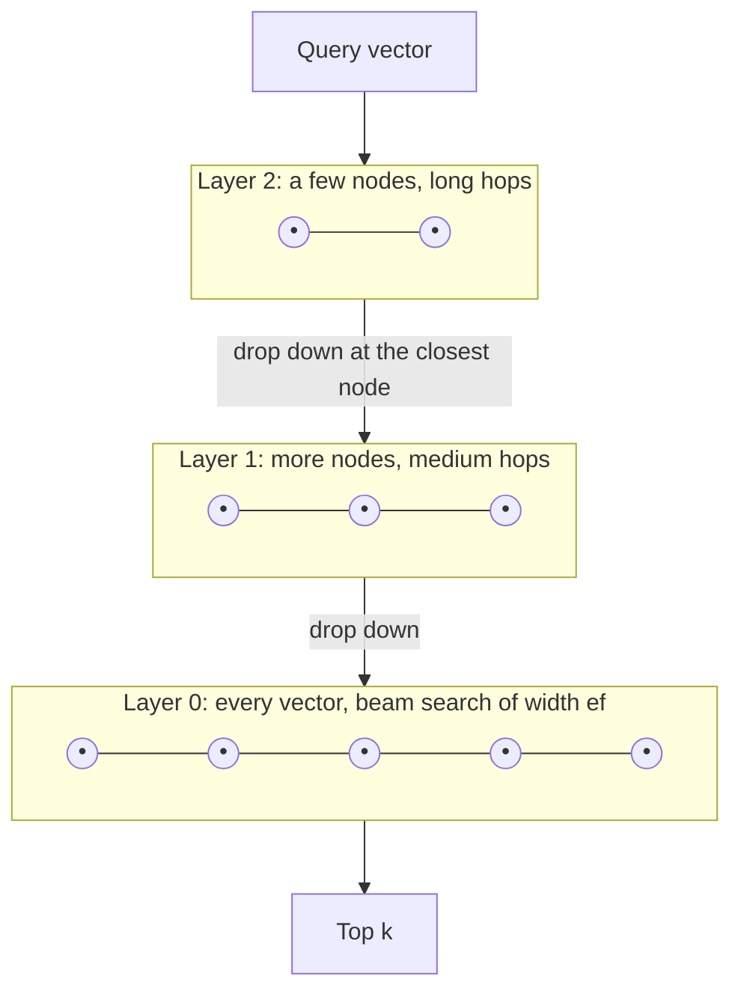

# vector-search-engine

An approximate nearest-neighbour index (HNSW) written from scratch in Python and NumPy, with an exact baseline and a benchmark that measures the accuracy-versus-work trade-off, including where it breaks down.

This is the data structure inside vector databases such as FAISS, Qdrant and pgvector. Building it is the clearest way to understand what `ef` and `M` actually do.

## How it works



Each vector is assigned a random top layer, with exponentially fewer nodes per layer. A search walks greedily through the sparse upper layers to get close, then runs a beam search of width `ef` on the bottom layer. Insertion uses the same search to find neighbours, then picks which to link with the paper's diversity heuristic so that edges point in different directions.

## Benchmark

`python -m vecsearch`: 20,000 synthetic vectors in 64 dimensions, grouped in 50 clusters to mimic embeddings, cosine distance, 200 held-out queries. Measured on a shared cloud container.

| Method | Recall@10 | Vectors compared per query | Share of dataset | Queries / second |
|---|---:|---:|---:|---:|
| Exact (NumPy brute force) | 1.000 | 20,000 | 100% | 3,922 |
| HNSW, ef=10 | 0.898 | 267 | 1.3% | 4,127 |
| HNSW, ef=20 | 0.979 | 349 | 1.7% | 2,935 |
| HNSW, ef=50 | 1.000 | 451 | 2.3% | 1,991 |
| HNSW, ef=100 | 1.000 | 501 | 2.5% | 1,436 |
| HNSW, ef=200 | 1.000 | 554 | 2.8% | 836 |

Build time was 62 s (about 320 inserts per second). The graph had 4 layers holding 20,000 / 1,230 / 83 / 5 nodes.

**What this shows, and what it does not:**

- The algorithm works: it reaches full recall while comparing about 2% of the dataset.
- It is **not faster in wall-clock time** at this size. The brute-force baseline is one vectorised BLAS call; this index is a Python loop over heaps. The win shown here is in work done, which is what carries over to a compiled implementation and to larger datasets. For real workloads use FAISS or hnswlib.
- The data is synthetic. Real embeddings will behave differently.

### Where it struggles

Queries drawn from clusters the index has never seen:

| Method | Recall@10 | Vectors compared per query |
|---|---:|---:|
| HNSW, ef=50 | 0.686 | 565 |
| HNSW, ef=200 | 0.895 | 1,047 |
| HNSW, ef=800 | 1.000 | 2,678 |

On tightly clustered data most edges stay inside a cluster, so a query that lands between clusters needs a much wider beam to find its true neighbours. This is a known weakness of graph indexes, and the reason `ef` should be tuned on queries that look like production traffic.

## Use it

```python
import numpy as np
from vecsearch import HNSWIndex

index = HNSWIndex(dim=384, metric="cosine", M=16, ef_construction=200)
ids = index.add_batch(embeddings)             # np.ndarray of shape (n, 384)

hits = index.search(query_vector, k=5, ef=50)  # [(id, distance), ...] closest first
index.delete(ids[0])                           # soft delete
index.save("index.npz"); index = HNSWIndex.load("index.npz")
```

| Parameter | Effect |
|---|---|
| `M` | Links per node. Higher means better recall and more memory. |
| `ef_construction` | Beam width while building. Higher means a better graph and slower inserts. |
| `ef` (at query time) | Beam width while searching. The main accuracy/speed dial. |

## Tests

`pytest -q` runs 9 tests, including: recall of at least 0.97 against the exact index, results sorted with distances matching the exact ones, a search touching under 40% of a small dataset, degree limits respected on every layer, soft delete, and a save/load round trip returning identical results.

```bash
pip install -e ".[dev]"
pytest -q
python -m vecsearch --n 20000
```

## Not implemented

Hard deletes with graph repair, filtered search, quantisation to shrink memory, and concurrent writes. Deleted nodes stay in the graph as waypoints, so an index with heavy churn should be rebuilt.
